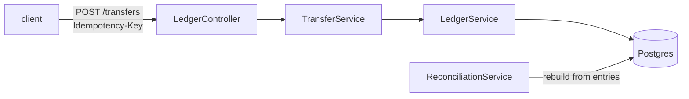

# tally

[](https://github.com/hirashif/tally/actions/workflows/ci.yml)

**Live API docs:** https://ledger-75986543116.us-central1.run.app/swagger-ui/index.html (seeded with a few accounts and transfers, so the endpoints return real data)

Double-entry ledger service in Java. Every transaction has to balance, entries are append-only,
balances are derived from history. Spring Boot, Postgres, plain SQL, Flyway, Testcontainers.



## Why I built this
Took a Bitcoin protocol class in college and wanted to actually see what my professor was
talking about, and pick up more of the fintech side while I was at it. Double entry is the
thing sitting under all of it and I'd never written one.

The tests were the annoying part. Getting Testcontainers to talk to Colima took longer than
any of the ledger code, and the concurrency bug wouldn't reproduce with twenty threads no
matter how many times I ran it. Ended up driving two connections by hand to catch it.

## Tables
| table | holds |
|---|---|
| `accounts` | name, currency, `balance_minor` (cached), `allows_overdraft` |
| `transactions` | one row per event |
| `entries` | the movements. integer cents, negative debits, positive credits |
| `idempotency_keys` | key, request hash, the transaction it produced |

Enforced by the database, not the app:
```
ERROR:  transaction 7 does not balance: entries sum to -5000
ERROR:  entries are append-only: UPDATE is not allowed
```

## Run it
Java 21 and a docker daemon ([colima](https://github.com/abiosoft/colima) here).

```bash
make up      # postgres
make run     # migrates, listens on 8080
make test    # 35 tests against real postgres
make psql
make down
```

## API
| | |
|---|---|
| `POST /accounts` | `allowsOverdraft` marks funding accounts |
| `GET /accounts/{id}` | account and balance |
| `GET /accounts/{id}/entries` | history, newest first |
| `POST /transfers` | needs an `Idempotency-Key` header |
| `GET /reconciliation` | balances that disagree with their entries |
| `GET /healthz` | |

```bash
# same request four times, money moves once
$ for i in 1 2 3 4; do curl -s -X POST localhost:8080/transfers \
    -H 'Idempotency-Key: pay-1' -H 'Content-Type: application/json' \
    -d '{"description":"alice pays bob 30","entries":[
         {"accountId":2,"amountMinor":-3000},{"accountId":3,"amountMinor":3000}]}'; done
{"transactionId":2}
{"transactionId":2}
{"transactionId":2}
{"transactionId":2}

# alice has $70
$ curl -s -X POST localhost:8080/transfers -H 'Idempotency-Key: overdraw' ...
{"error":"account 2 has 7000 and cannot move -50000"}   # 422
```

## Notes
- Cents as `BIGINT`, no floats. Validation uses `Math.addExact`, since `Long.MAX_VALUE + Long.MAX_VALUE + 2` wraps to zero and reads as balanced.
- Zero-sum check is a `DEFERRABLE INITIALLY DEFERRED` trigger so it runs at commit. Per-row it would reject a valid transfer at the first leg.
- Trigger raises `ERRCODE = 'check_violation'` instead of a bare `RAISE`, so Spring maps it to a normal integrity violation.
- Append-only broke my test cleanup before anything else. `DELETE` trips the trigger, tests `TRUNCATE`.
- No "does this key exist" check on idempotency. Two retries would both find nothing and both post. Insert and let the primary key decide; loser replays. Request hash catches same key + different body (409).
- Key is claimed before any business rule runs, so a replay stays a replay even if the body is bad.
- `SELECT ... FOR UPDATE` on every account in the transaction before reading a balance, ordered by id. Otherwise both transfers see $100, both approve $80, account lands at -$60.
- I first locked only the debited accounts. The credit side takes a row lock too when its entry is written, so A->B and B->A deadlocked: about half of 600 opposite transfers were aborted by Postgres. Locking both sides in id order fixed it, and `OppositeTransferTest` keeps it fixed.
- `balance_minor` is cached in the same transaction as the entries, so two sources of truth. `/reconciliation` rebuilds from entries and reports drift. A test corrupts a balance on purpose to check it.
- `LostUpdateTest` drives two connections by hand. Twenty threads never reproduced the race.

## Next
- Multi-currency. Currency is per account but not enforced across a transaction.
- Partition `entries` by month, incremental reconciliation.
- Outbox table so other services don't read this database.
- Scheduled reconciliation with alerting.

## Layout
```
src/main/java/com/hirashif/ledger/
  LedgerController.java       rest surface, ApiErrors maps exceptions to codes
  TransferService.java        request hashing, replay on duplicate key
  LedgerService.java          validation, locking, solvency, posting
  ReconciliationService.java  drift detection and repair
src/main/resources/db/migration/   V1 schema + triggers, V2 idempotency, V3 overdraft, V4 cached balances
```
